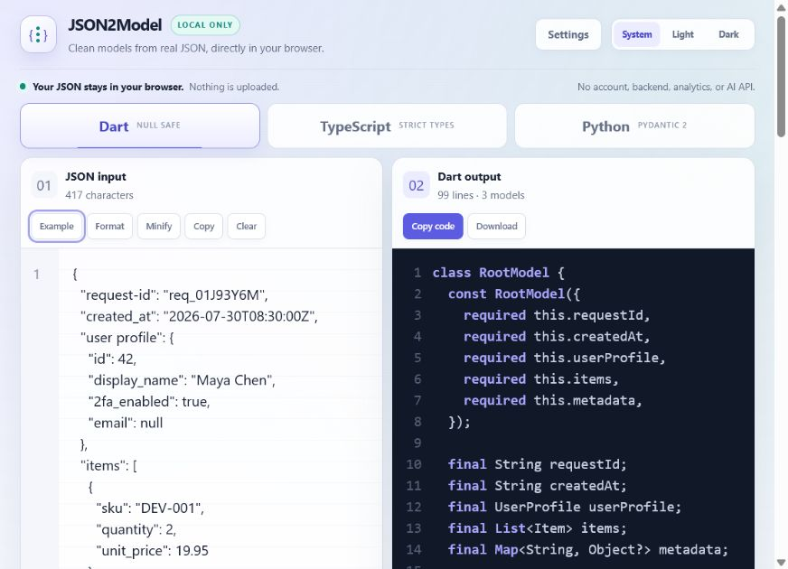
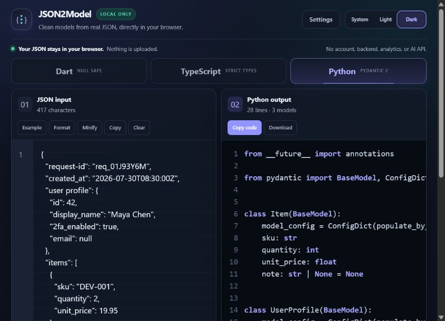
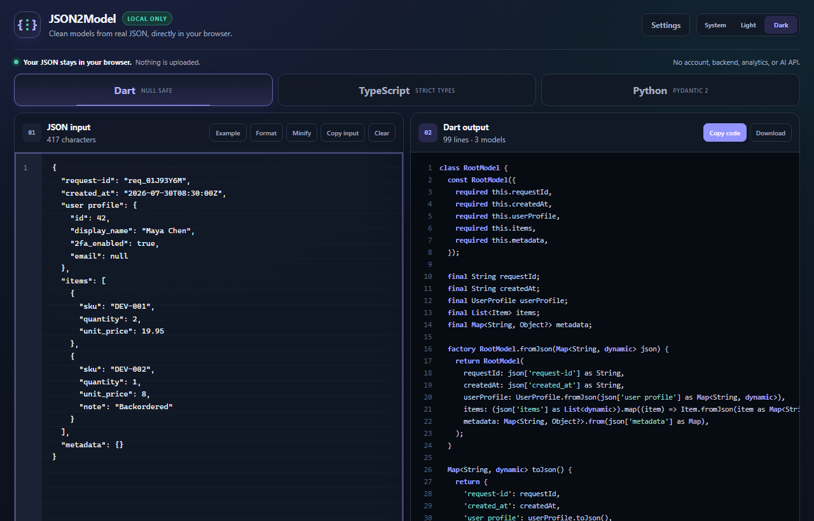
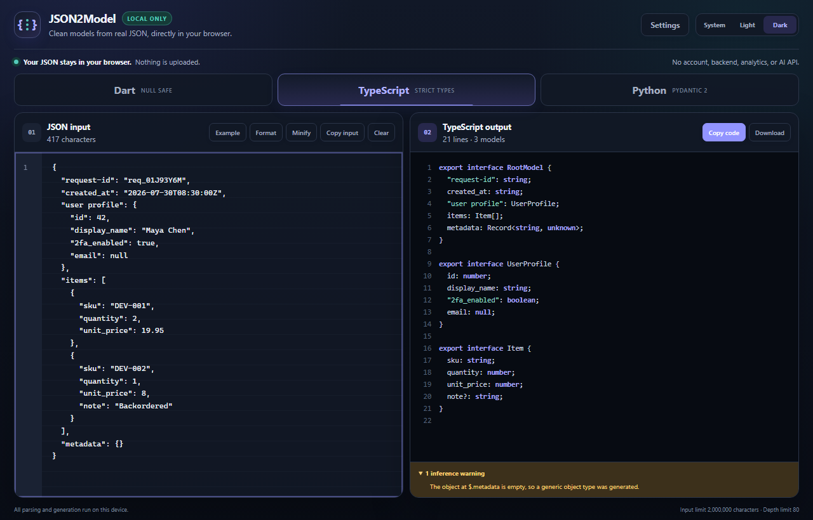
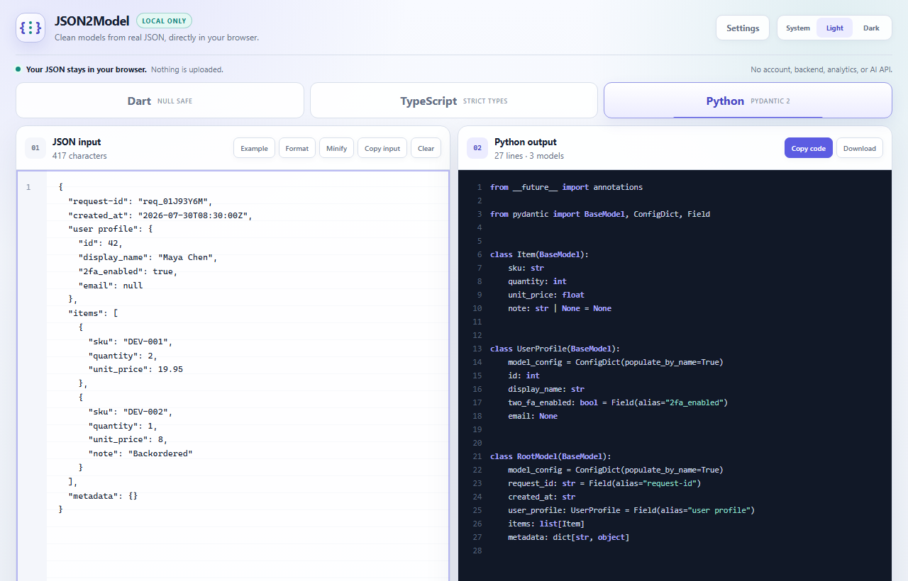
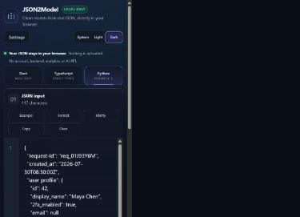
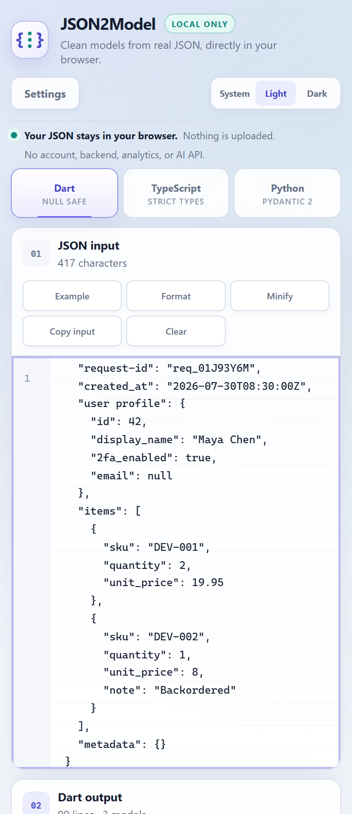

# JSON2Model

Paste a JSON document, pick Dart, TypeScript, or Python, and get a typed model you
can drop into a project. It runs as a static page with no build step for the user,
no account, and no server involved in the conversion. The converter is the first
thing on screen when the page loads.

Your JSON stays in your browser. The page has no backend, no analytics, no error
reporting service, and no AI API. Nothing you paste is written to browser storage
unless you turn on the remember input setting yourself. A browser test asserts
that no request leaves the page origin during a conversion and that the pasted
text never reaches local storage, session storage, or a cookie.



## Supported output

| Target     | What it generates                                                                                                                                   |
| ---------- | --------------------------------------------------------------------------------------------------------------------------------------------------- |
| Dart       | Immutable null safe classes, named constructor parameters, `fromJson`, `toJson`, nested models, typed lists, numeric widening, original key mapping |
| TypeScript | Interfaces or type aliases, optional and nullable properties, unions, arrays, optional readonly modifiers, quoted original keys                     |
| Python     | Pydantic 2 `BaseModel` classes, modern or legacy union syntax, `Field` aliases for original keys, nested models, `RootModel` for non object roots   |

The input can be an object, an array of objects, an array of primitives, or a bare
primitive. Objects in an array are merged, so a property missing from any element
becomes optional while a property that is sometimes null becomes nullable. Empty
arrays, empty objects, and arrays with incompatible element types fall back to a
safe type and say so in the warning list.

## Example

Input:

```json
{
  "request-id": "req_01J93Y6M",
  "user profile": {
    "display_name": "Maya Chen",
    "2fa_enabled": true,
    "email": null
  },
  "items": [
    { "sku": "DEV-001", "quantity": 2, "unit_price": 19.95 },
    { "sku": "DEV-002", "quantity": 1, "unit_price": 8, "note": "Backordered" }
  ]
}
```

Dart:

```dart
class Item {
  const Item({
    required this.sku,
    required this.quantity,
    required this.unitPrice,
    this.note,
  });

  final String sku;
  final int quantity;
  final double unitPrice;
  final String? note;

  factory Item.fromJson(Map<String, dynamic> json) {
    return Item(
      sku: json['sku'] as String,
      quantity: json['quantity'] as int,
      unitPrice: (json['unit_price'] as num).toDouble(),
      note: json['note'] == null ? null : json['note']! as String,
    );
  }

  Map<String, dynamic> toJson() {
    return {
      'sku': sku,
      'quantity': quantity,
      'unit_price': unitPrice,
      'note': note,
    };
  }
}
```

`unit_price` is `19.95` in one element and `8` in the other, so the field widens to
`double` and `fromJson` converts through `num`. `note` is missing from the first
element, so it becomes optional and nullable. The original keys stay in `fromJson`
and `toJson`.

Python for the same input:

```python
from __future__ import annotations

from pydantic import BaseModel, ConfigDict, Field


class UserProfile(BaseModel):
    model_config = ConfigDict(populate_by_name=True)
    display_name: str
    two_fa_enabled: bool = Field(alias="2fa_enabled")
    email: None
```

TypeScript keeps the original keys, because a type cannot rename a key at runtime:

```ts
export interface RootModel {
  "request-id": string;
  "user profile": UserProfile;
  items: Item[];
}
```

Turning on the camelCase setting for TypeScript adds a warning that says the type
no longer matches the incoming JSON shape.

<details>
<summary>More screenshots</summary>

Dark mode:



Dart output:



TypeScript output:



Python output:



The panels stack on a narrow screen:




</details>

## Features

1. Validation with a line and column when the browser reports one, and a plain
   description of what was expected when it does not
2. Format, minify, clear, load example, copy input, copy output, and download
3. Warnings that name the path where inference had to guess, collapsed so a large
   array reports one warning per place rather than one per element
4. Per language settings, including root model name, date detection, comments,
   property order, and the unknown value strategy
5. Light, dark, and system themes, with settings kept in local storage
6. Keyboard shortcuts for formatting and copying, and a visible focus ring on
   every control
7. Deterministic output: the same input and settings always produce the same text

## Local setup

Requirements: Node.js 22.13 or newer and npm 10 or newer.

```bash
npm install
npm run dev
```

The dev server prints a local address. Nothing else has to be installed to use the
converter itself.

## Commands

| Command                       | What it does                                           |
| ----------------------------- | ------------------------------------------------------ |
| `npm run dev`                 | Start the dev server                                   |
| `npm run build`               | Build the static site into `dist`                      |
| `npm run preview`             | Serve the built site                                   |
| `npm run lint`                | ESLint with type aware rules                           |
| `npm run typecheck`           | `tsc --noEmit`                                         |
| `npm run format`              | Rewrite files with Prettier                            |
| `npm run format:check`        | Fail if anything is unformatted                        |
| `npm test`                    | Unit and component tests                               |
| `npm run test:unit`           | Unit tests only                                        |
| `npm run test:component`      | Component tests only                                   |
| `npm run test:e2e`            | Browser tests against the dev server                   |
| `npm run test:e2e:production` | Browser tests against the built site                   |
| `npm run verify`              | Format check, lint, typecheck, tests, and build        |
| `npm run fixtures:generate`   | Write generated models for every fixture               |
| `npm run validate:typescript` | Compile the generated TypeScript with strict settings  |
| `npm run validate:python`     | Ruff and Pydantic over the generated Python            |
| `npm run validate:dart`       | Dart analyzer and a round trip over the generated Dart |
| `npm run desktop:build`       | Package the Windows desktop application                |
| `npm run desktop:smoke`       | Drive the packaged application and check it converts   |

Browser tests need their browser once:

```bash
npx playwright install chromium
npm run test:e2e
```

## Tests

Unit and component tests run under Vitest, and browser tests run under Playwright
against both the dev server and the real production build.

Generated code is checked by the language toolchains rather than by string
comparison. `npm run fixtures:generate` writes every fixture through all three
generators into `tests/generated`, including the cases that are easy to get wrong:
keys that collide after conversion, keys containing `$`, keys that match a Dart
class member or a Pydantic reserved name, keys that cannot be a Dart identifier at
all, reserved words, nested lists, unions, empty values, and every root shape. Then:

- `npm run validate:typescript` compiles all of it with `strict`,
  `noUncheckedIndexedAccess`, and `exactOptionalPropertyTypes`
- `npm run validate:python` runs Ruff and then imports every module and validates
  the original fixture through it with Pydantic 2
- `npm run validate:dart` runs the analyzer and then a round trip that parses each
  fixture and serializes it again, failing if a key is lost

Python validation needs Python 3.11 or newer with Pydantic 2 and Ruff. Dart
validation needs the Dart SDK.

```bash
python -m pip install "pydantic>=2,<3" ruff
```

## Production build and deployment

```bash
npm ci
npm run build
```

Publish `dist`. Asset paths are relative, so the same output works at a domain
root and under a repository path. The build injects a Content Security Policy that
sets `connect-src 'none'`, so the published page cannot make a network request at
all.

`.github/workflows/deploy-pages.yml` publishes `dist` to GitHub Pages after CI
succeeds on `main`. See [docs/deployment.md](docs/deployment.md) for other hosts
and for the response headers a host can add.

## Windows desktop application

`npm run desktop:build` wraps the same static build in Electron and writes
`release/win-unpacked`. `JSON2Model.exe` there opens the converter in its own
window with no runtime to install and no internet connection needed. The renderer
runs with context isolation on, Node integration off, and the Electron sandbox
enabled; the only thing exposed to the page is a size limited clipboard write.

The executable is not code signed, so Windows SmartScreen shows an unknown
publisher warning.

## Project structure

```text
src/components/         Converter interface, settings, syntax highlighting
src/generators/         Dart, TypeScript, and Python generators plus shared parts
src/naming/             Identifier rules per language
src/parser/             JSON parsing, friendly errors, input limit
src/schema/             Language independent schema inference
src/hooks/              Preference storage
src/styles/             Global stylesheet
electron/               Desktop shell and preload bridge
scripts/                Fixture generation, screenshots, desktop smoke test
tests/unit/             Parser, schema, naming, generator, storage tests
tests/component/        React interaction tests
tests/browser/          Playwright tests
tests/fixtures/         Representative JSON documents
docs/                   Architecture, inference, deployment notes
```

Parsing, inference, and generation are plain TypeScript with no React import, so
they can be used without the interface. See
[docs/architecture.md](docs/architecture.md) and
[docs/inference.md](docs/inference.md).

## Known limitations

1. Numbers pass through `JSON.parse`, so an integer beyond 2^53 loses precision
   before inference sees it. A warning appears and the field keeps an integer
   type. Use a JSON string when the exact digits matter.
2. An empty array cannot reveal its element type, so the configured unknown type
   is used and a warning explains why.
3. Dart has no untagged union. A value that is sometimes an object and sometimes
   another type becomes `Object?` or `dynamic`, and no class is generated for the
   object shape. A warning names the path.
4. Dart identifiers are ASCII only. A key written in another script gets a
   generated field name, and the original key is still used for serialization.
5. A TypeScript declaration cannot rename a key at runtime. Original keys are kept
   by default, and converting them adds a warning.
6. Generated Dart is analyzer clean but is not byte identical to `dart format`
   output. The formatter collapses short parameter lists that the generator writes
   one per line.
7. Date detection is off by default and matches only full ISO shaped strings.
8. Conversion runs on the main thread. React defers the work so typing stays
   responsive, and the input limit is 2,000,000 characters with a depth limit of
   80 levels and a limit of 50,000 visited values. Past those limits the page
   explains the limit instead of continuing.
9. Only Dart, TypeScript, and Python are supported. Adding a language means adding
   a generator against the existing schema.

## Contributing

Read [CONTRIBUTING.md](CONTRIBUTING.md). Generator changes should come with a unit
test for the shape that changed and, when the change affects generated code, a
fixture so the language toolchains check it.

## Security

Report a vulnerability through the process in [SECURITY.md](SECURITY.md).

## License

[MIT](LICENSE).
